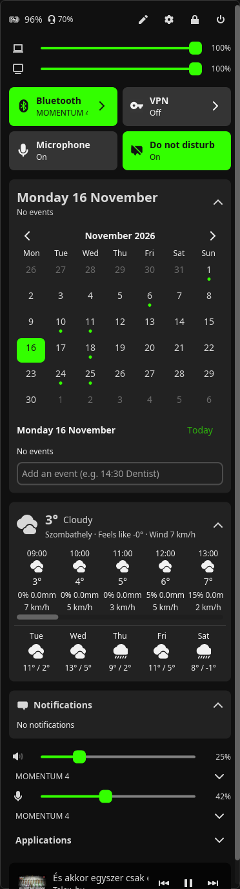
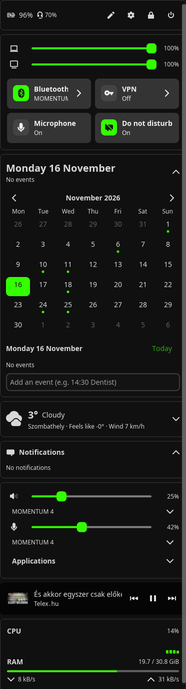
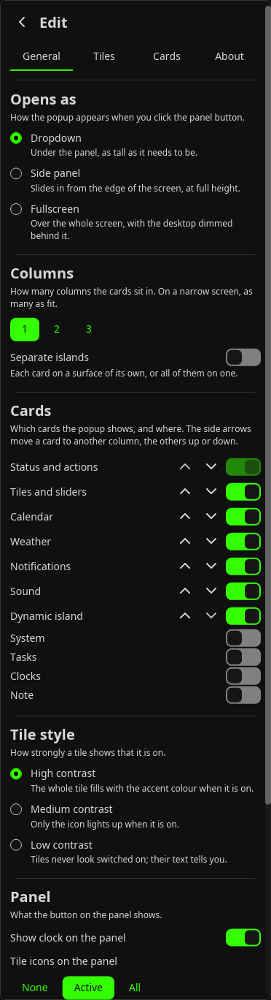
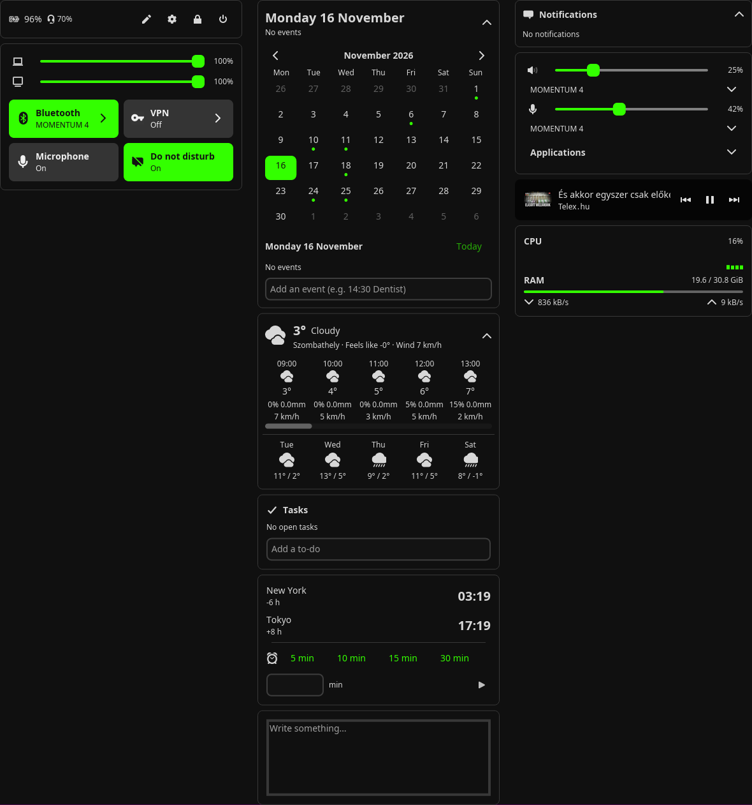

# Orbit

**A control panel applet for the COSMIC™ desktop** — quick toggles, sliders,
your calendar, the weather, your notifications and a "dynamic island" for
what's playing, filming or recording, all in one popup on your panel. Think
the Windows 11 quick settings or a phone's control center, built natively
for the COSMIC™ desktop with libcosmic, following your system theme.

<p align="center">
  
</p>

<p align="center">
  
  
  
</p>
<p align="center">
  
</p>

## Install

**From the COSMIC Store:** search for *Orbit* (it's listed under
**Applets**), install it, then add it to the panel in **Settings → Desktop
→ Panel → Applets → Add applet → Orbit**.

Building it yourself, or as a local Flatpak: see [Building](#building).

## Features

### On the panel
- Status icons: network, VPN, Bluetooth, volume, battery (its charge, and a
  bolt while plugged in), notifications, and the camera or microphone in
  use.
- The clock, and optionally the weather and the pomodoro's time left.
- The tiles' own icons: none, only the active ones, or all of them with the
  inactive ones faint.
- The space between them: small, medium, large, or **native** (COSMIC's
  interface density).
- **Badges** for what's worth knowing without opening the popup: the
  battery turns red at 20% or less unless charging, and a dropped Wi-Fi
  shows red for 30 seconds, a minute, five, or until it's back (off by
  default).

### The popup
- Opens as a **dropdown** under the panel, a **side panel** sliding in from
  the edge, or **fullscreen**.
- Made of **cards**, each shown or hidden, in **one, two or three columns**
  (as many as the screen has room for), in any order; on one surface or as
  **separate islands**.
- Follows your **Appearance** settings: accent color, dark or light,
  roundness and **frosted glass**. On a bright accent (lime, yellow…) text
  turns black so it stays readable.
- **Live in both directions**: Orbit listens to NetworkManager, BlueZ,
  UPower, power-profiles-daemon, PipeWire, the compositor and COSMIC's own
  settings, so changes made anywhere else show up at once.

### Status
Your picture and name (AccountsService); the battery with the time until
it's empty or full; the charge of mice, keyboards, headsets and phones;
updates waiting (packages and Flatpaks, opening the COSMIC Store); and the
editor, COSMIC Settings, lock and power off.

### Tiles and sliders
Wi-Fi · Bluetooth · VPN · Power mode · Do not disturb · Dark style ·
Airplane mode · Microphone · Keep awake · Tiling · Magnifier · Invert colors
· Screen reader · High contrast · Touchpad · Hotspot · Pomodoro · Keyboard
layout · DNS · Game Mode · Displays · Drives, plus shortcuts to Screenshot
and Workspaces — and **tiles of your own**.

- **Click** a tile to switch it; **its arrow** opens its page:
  - **Wi-Fi**: networks to join (with a password prompt); the one in use
    opens its **details** — IPv4 and IPv6 address, gateway, DNS, each to
    copy — and shares itself as a **QR code** when you ask.
  - **Wired**: the same details.
  - **Bluetooth**: devices to connect, with their battery level.
  - **VPN**: connections to bring up or down.
  - **Power mode**: power profiles, and the battery's **charge limit**
    where UPower can stop charging short of full.
  - **Hotspot**: its name, password and a QR code to join it.
  - **Keep awake**: for 30 minutes, 1, 2 or 4 hours, or until turned off.
  - **Keyboard layout**: the layouts set in COSMIC (the tile itself switches
    to the next one).
  - **DNS**: the connection's own servers, or Cloudflare, Google, Quad9 or
    AdGuard, over IPv4 and IPv6, set through NetworkManager without a
    password.
  - **Displays**: each one on or off, its scale, or mirroring another
    (through `cosmic-randr`).
  - **Drives**: removable drives that are mounted, to open or eject
    (UDisks2; the tile shows only while one is plugged in).
  - **Pomodoro**: the timer, whether it shows on the panel, and **Do not
    disturb while focusing**.
- **Game Mode** holds Feral GameMode on (shown only where it's installed).
- **Your own tiles**: any command as a tile, with an icon; optionally a
  status command that lights the tile while it succeeds, and asking before
  it runs. Installed launchers (Terminal, Files, Text editor, System
  monitor, App store) are offered as one-click tiles.
- **Sliders**: volume (its arrow: outputs, microphones and each app's
  volume), screen brightness, **external monitors' brightness** over DDC/CI
  (where `ddcutil` is installed), and the keyboard backlight, each with its
  level.
- **Edit**: drag to reorder, click to switch between wide (name and state)
  and small (icon only), remove with −, add with +, or reset. Tiles can be
  lit fully (high contrast), only their icon (medium) or never (low).

### Cards
- **Calendar**: today and your next event at a glance; open, the month,
  with the weeks around filled in faint, a **Today** button, dots on busy
  days, the picked day's events, and **Join** buttons for Google Meet, Zoom,
  Teams, Jitsi, Webex, Whereby and GoTo meetings. Type an event for the
  picked day: "14:30 Dentist" for an hour from then, or all day without a
  time. Events come from the calendars synced to the system (Evolution Data
  Server, filled by GNOME Online Accounts: Google, Microsoft 365, Nextcloud,
  CalDAV…), repeating events included.
- **Weather**: now (temperature, feels like, wind), the next 6, 12 or 24
  hours (five at a time, scrolled sideways: temperature, chance and amount
  of rain or snow, wind) and 3, 5 or 7 days ahead, from
  [Open-Meteo](https://open-meteo.com) — free, no account. Your city, picked
  with suggestions as you type, or your time zone's. Fahrenheit where the
  region uses it; can show on the panel too.
- **Notifications**: as COSMIC shows them, newest first, kept after their
  popups go and across restarts (for a week, readable only by you; ones
  their apps mark transient are never saved). Click one to open it, dismiss
  one or all.
- **Dynamic island**: what's running that you should know about — the media
  playing (any MPRIS player) with its cover, controls and a position to
  seek; a video meeting about to start, with a Join button; the pomodoro
  while it runs; and apps using the **camera** (green) or the **microphone**
  (orange), also shown on the panel.

Off until you turn them on:
- **Sound**: output and microphone levels, each with its device (a click
  lists the others), and every playing app's volume. It takes the volume
  slider over from the tiles.
- **System**: processor use with its last minute as bars, memory, the
  network's speed down and up, and the five busiest processes by processor
  or memory, your own ones to end (asked first).
- **Tasks**: the open to-dos of your synced task lists (Google Tasks,
  Nextcloud…), soonest due first; tick one off, or type a new one.
- **Note**: a note that stays.
- **Docker**: the Compose stacks (running ones first, with how many of
  their containers run), each opening to its services and their state.
  - a stack: **start, stop, restart** (by its labels: no compose file
    needed), and a **terminal in its folder** for the rest (`up --build`…);
  - a service: **start, stop, restart**, its **log** (followed) or a
    **shell** in it in COSMIC's terminal, and its published web port
    **in the browser** (databases' and queues' ports left out).

  Containers outside Compose are listed together. Nothing that removes
  anything (`down`, `prune`) is offered.
- **SSH**: the hosts of `~/.ssh/config` (and what it includes) and the
  places you connected to lately, searchable; or type `user@host`. A click
  opens `ssh` in COSMIC's terminal.
- **Open ports**: search by port number or program; without a search, the
  well-known ones that listen (FTP, SSH, HTTP, HTTPS, common development
  ports), five at most. Each with what it's for and the process where it's
  yours; open a web one in the browser, or end its process (asked first).
- **Virtual machines**: libvirt's (`qemu:///system`), with their state;
  start one, ask it to shut down, or open its screen in `virt-viewer`.
- **Services**: systemd's services, the system's or yours. Search by name
  or description (installed but unloaded ones too); without a search, the
  ones you pinned and any that failed. Each shows its state, and can be
  **started, stopped or restarted** (the system's ask for your password,
  through COSMIC's own dialog) or open its **journal**, followed, in COSMIC's
  terminal.
- **Clocks**: other cities' time, and timers of 5, 10, 15 or 30 minutes or
  any length, which notify when they end.

### Pomodoro
25 minutes of focus, a 5-minute break, 15 minutes after every fourth; each
phase starts the next with a notification. Start, pause, skip and reset from
its tile, its page or the island; optionally with Do not disturb on while
you focus.

### Settings
The editor (the pencil in the popup) has four tabs, each setting with a
line on what it does:
- **General**: how the popup opens, its columns, separate islands, which
  cards show and where, the tiles' style, what the panel shows, and badges.
- **Tiles**: the tile grid, tiles to add, and your own tiles.
- **Cards**: each card's own settings — the weather's place and how much of
  it shows, the clocks' cities.
- **About**: version, links, license.

### VPN and Wi-Fi passwords that just work
Connections whose password is stored "for this user only" (agent-owned)
can only connect while a NetworkManager *secret agent* answers for them.
COSMIC Settings is one — but only while it's open, which is why VPNs often
fail to connect from other applets. **Orbit is a secret agent itself**:

1. it looks the password up in your keyring (GNOME Keyring / Secret
   Service), unlocking it with the keyring's own dialog if it's locked;
2. if it isn't there, it asks in the popup, and can remember it in the
   keyring for next time.

Only NetworkManager itself may ask Orbit for secrets; other callers are
refused.

### Localization
Orbit speaks the 76 languages COSMIC itself is translated into, following
your interface language (`LC_MESSAGES`), with English for anything a
translation lacks. Dates, month and day names, the first day of the week and
the 12/24-hour clock follow your **region format** (`LC_TIME`) through ICU,
as COSMIC's own clock does — so an English system with Hungarian formats
shows "október 29., csütörtök".

Most translations are machine-made to start with: corrections from native
speakers are very welcome (see [Translations](#translations)).

### Privacy
- Weather: the chosen place's coordinates (or the time zone's city name) go
  to Open-Meteo. Nothing else leaves the computer.
- Your own tiles and the note are kept in Orbit's own folder, readable only
  by you (in the Flatpak, private to Orbit), not in COSMIC's shared settings.
- A Wi-Fi password shows only on the hotspot's page, or as a QR code when
  you ask to share the network in use.

## Requirements

- COSMIC desktop 1.11 or newer (built against the same libcosmic as
  COSMIC 1.11's own applets; tested on Pop!_OS 24.04)
- NetworkManager, BlueZ, UPower, power-profiles-daemon
- PipeWire with WirePlumber (`wpctl`) and `pactl`
- `curl` (weather, cover art), `cosmic-settings`, `cosmic-osd`,
  `cosmic-randr` (displays)
- Optional:
  - calendar events and to-dos: `evolution-data-server` and
    `gnome-online-accounts-gtk`
  - external monitors' brightness: `ddcutil`, with access to `/dev/i2c-*`
    (the `i2c` group)
  - drives: UDisks2; your picture and name: AccountsService; Game Mode:
    `gamemode`
  - the Docker card: `docker` (Compose v2), usable without `sudo` (the
    `docker` group), and `cosmic-term`
  - virtual machines: libvirt (`virsh`, the `libvirt` group) and
    `virt-viewer`

## Building

### Dependencies

```sh
sudo apt install build-essential pkg-config libxkbcommon-dev libwayland-dev \
    pulseaudio-utils curl git
```

Rust (1.93 or newer, as libcosmic asks) from [rustup.rs](https://rustup.rs):

```sh
curl --proto '=https' --tlsv1.2 -sSf https://sh.rustup.rs | sh
```

### Build and install

```sh
git clone https://github.com/danielhanzs/cosmic-ext-applet-orbit.git
cd cosmic-ext-applet-orbit
./install.sh            # installs into ~/.local
# or system wide:
# sudo ./install.sh /usr
```

Then add it in **Settings → Desktop → Panel → Applets → Add applet →
Orbit**. If it isn't in the list, log out and back in once, so the panel
picks up the new desktop entry.

### Optional extras

```sh
# calendar and to-dos
sudo apt install evolution-data-server gnome-online-accounts-gtk
gnome-online-accounts-gtk     # add your Google / Microsoft / Nextcloud account
# external monitors' brightness (log out and in after)
sudo apt install ddcutil && sudo usermod -aG i2c "$USER"
```

### As a local Flatpak

```sh
flatpak install --user flathub org.flatpak.Builder org.freedesktop.Sdk//25.08 \
    org.freedesktop.Sdk.Extension.rust-stable//25.08 com.system76.Cosmic.BaseApp//stable
flatpak run org.flatpak.Builder --user --install --force-clean \
    flatpak/build flatpak/local.json
```

`flatpak/local.json` builds the working tree, fetching crates as it builds.
`flatpak/io.github.danielhanzs.CosmicExtAppletOrbit.json` is the manifest
for the COSMIC Flatpak repository: it builds the release tag offline, from
`flatpak/cargo-sources.json`, which `flatpak/generate-sources.sh` makes from
`Cargo.lock`.

In the sandbox Orbit runs `wpctl`, `pactl`, `curl`, `cosmic-randr`,
`ddcutil`, `cosmic-settings`… on the host through `flatpak-spawn --host`,
as COSMIC applets in Flatpak do.

### Updating

```sh
cd cosmic-ext-applet-orbit
git pull
./install.sh
```

The panel keeps running the old binary until the applet restarts: log out
and in, or remove Orbit from the panel and add it again.

### Uninstalling

Remove Orbit from the panel first, then:

```sh
rm ~/.local/bin/cosmic-ext-applet-orbit \
   ~/.local/share/applications/io.github.danielhanzs.CosmicExtAppletOrbit.desktop \
   ~/.local/share/icons/hicolor/scalable/apps/io.github.danielhanzs.CosmicExtAppletOrbit*.svg
rm -r ~/.config/cosmic/io.github.danielhanzs.CosmicExtAppletOrbit   # settings
rm -r ~/.config/io.github.danielhanzs.CosmicExtAppletOrbit          # your tiles, the note
rm -r ~/.cache/io.github.danielhanzs.CosmicExtAppletOrbit           # cover art
```

## Troubleshooting

What Orbit finds on this system, one line a service:

```sh
cosmic-ext-applet-orbit --check
# in the Flatpak:
flatpak run io.github.danielhanzs.CosmicExtAppletOrbit --check
```

The panel collects the applet's log:

```sh
journalctl --user -f | grep CosmicExtAppletOrbit
```

More detail: set `RUST_LOG=cosmic_ext_applet_orbit=debug` in the
environment the panel starts with.

- **No calendar events or to-dos** — check that `evolution-data-server` is
  installed and an account is added in GNOME Online Accounts.
- **VPN asks for a password every time** — turn on *Remember* in the prompt.
- **No brightness slider** — the screen exposes no backlight to COSMIC
  (common on desktop monitors); for external monitors install `ddcutil` and
  join the `i2c` group (see [Optional extras](#optional-extras)).
- **No Game Mode tile** — `gamemode` isn't installed.
- **No Drives tile** — it shows only while a removable drive is mounted.
- **Docker card says Docker isn't reachable** — check that `docker ps`
  works without `sudo`.

## Development

```sh
cargo build --release
cargo test
```

| File | What it does |
|------|--------------|
| `src/app.rs` | the applet: panel button, popup layouts, tiles, cards, pages, editor |
| `src/sys.rs` | NetworkManager (incl. DNS, details, hotspot), BlueZ, UPower, power profiles, brightness, drives, the user, change signals |
| `src/agent.rs` | NetworkManager secret agent and keyring access |
| `src/audio.rs` | volume, outputs, microphone and camera use |
| `src/media.rs` | MPRIS player, cover art, seeking |
| `src/calendar.rs` | Evolution Data Server events, adding events |
| `src/tasks.rs` | Evolution Data Server to-dos |
| `src/weather.rs` | Open-Meteo weather and place search |
| `src/notifications.rs` | the notification center's feed and history |
| `src/system.rs` | processor, memory and network use |
| `src/ddc.rs` | external monitors' brightness over DDC/CI |
| `src/displays.rs` | displays through cosmic-randr |
| `src/dev.rs` | SSH hosts, listening ports, the busiest processes, libvirt's machines |
| `src/services.rs` | systemd's services through systemctl, and their journal |
| `src/docker.rs` | Docker's Compose stacks and containers, their logs and shells |
| `src/keyboard.rs` | the keyboard layouts set, and their names |
| `src/workspaces.rs` | tiling and the keyboard layout in use, from the compositor |
| `src/desktop.rs` | accessibility, touchpad, keep awake, tiling, Game Mode, notifications sent |
| `src/pomodoro.rs` | the pomodoro timer |
| `src/updates.rs` | counting updates |
| `src/config.rs` | saved preferences, your tiles and note, COSMIC settings |
| `src/check.rs` | `--check`: what Orbit finds on this system |
| `src/i18n.rs` | loading translations, date formats |
| `src/icons.rs`, `src/style.rs` | drawn icons and QR codes; tile and button styles |
| `src/swipe.rs` | lets sideways swipes reach sideways lists inside the popup |
| `src/host.rs`, `src/bus.rs` | host programs and files (from a Flatpak too); shared D-Bus connections |
| `i18n/<language>/cosmic_ext_applet_orbit.ftl` | the words, one file per language |

### Screenshots

`ORBIT_PREVIEW` starts Orbit with its popup open by itself, set for that run
only (nothing is saved), framed in magenta to cut it out of a screenshot:

```sh
LC_ALL=en_GB.UTF-8 ORBIT_PREVIEW=dropdown,islands,calendar,weather ./target/release/cosmic-ext-applet-orbit
```

Your name and picture stay out of a preview (its screenshots go public),
unless `user` is among the options.

Options:
- layout: `dropdown`, `side`, `fullscreen`; `islands`, `single`; `1`, `2`,
  `3` (columns); `medium`, `low` (tile styles)
- cards open or added: `calendar`, `weather`, `audio`, `system`, `tasks`,
  `clocks`, `notes`, `docker` (its first stack open), `services`, `ssh`,
  `ports`, `vms`;
  `find:<text>` searches the services card for that
- a page: `displays`, `network`, `keepawake`; the editor on a tab:
  `general`, `tiles`, `cards`
- `user`: your name and picture in the header

### Releasing

```sh
./release.sh 0.8.0 "What changed, in a sentence or two."
./release.sh --dry-run 0.8.0 "..."   # shows what it would do, changes nothing
FLATPAK_BRANCH=cosmic-ext-applet-orbit-v0.7.0 ./release.sh 0.8.0 "..."   # updates that open pull request
```

Bumps the version (Cargo, AppStream metainfo with the notes, the Flatpak
manifest), regenerates `flatpak/cargo-sources.json`, runs the tests, commits,
tags and pushes, then updates the cosmic-flatpak fork in `../cosmic-flatpak`
(a new update branch, or the one named) — you write that commit's message
— and prints the links for the GitHub release and the pull request.

### Translations

The words live in [Fluent](https://projectfluent.org) files,
`i18n/<language>/cosmic_ext_applet_orbit.ftl`, one `id = text` per line, as
in COSMIC's own applets. To fix or add a language, edit or copy
`i18n/en/cosmic_ext_applet_orbit.ftl`, keep the ids, translate the text, and
open a pull request; `cargo test` checks every file has every id and loads.

## Credits

- Inspired by DrakRosmann's
  [cosmic-ext-applet-quick-settings](https://github.com/DrakRosmann/cosmic-ext-applet-quick-settings),
  whose approach to COSMIC's settings and protocols informed this rewrite.
- Several ideas — tiles of your own, panel badges, DNS switching, Game Mode,
  the charge limit, `--check`, described settings — come from jjnuthuagen's
  [cosmic-control-center-applet](https://github.com/jjnuthuagen/cosmic-control-center-applet).

## Trademarks

COSMIC™ is a trademark of System76, Inc. Orbit is an independent project for
the COSMIC™ desktop, not made or endorsed by System76.

## License

[GPL-3.0-only](LICENSE)
