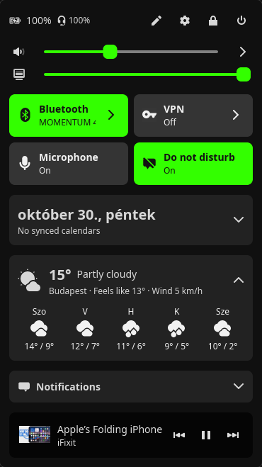
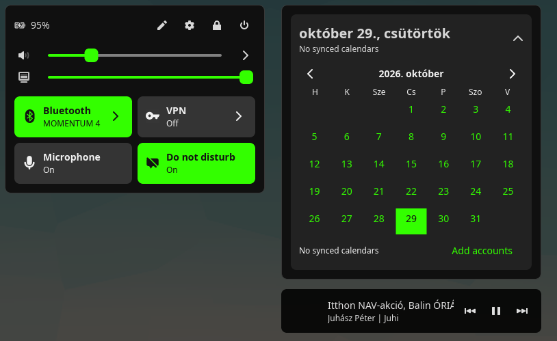
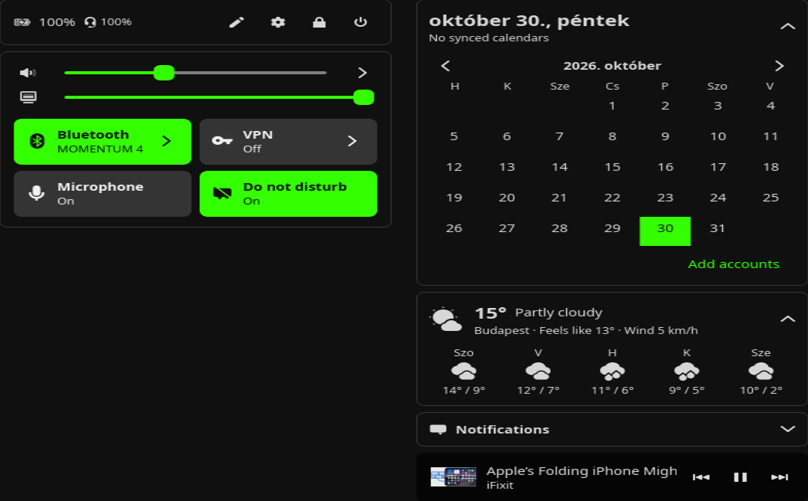

# Orbit

**A control panel applet for the COSMIC desktop** — quick toggles, sliders,
your calendar, the weather, your notifications and a "dynamic island" for
what's playing, filming or recording, all in one popup on your panel. Think
the Windows 11 quick settings or a phone's control center, built natively
for COSMIC with libcosmic, following your system theme.

<p align="center">
  
</p>

<p align="center">
  
  
</p>
<p align="center">
  
</p>

## Features

### Quick tiles
Wi-Fi · Bluetooth · VPN · Power mode · Do not disturb · Dark style ·
Airplane mode · Microphone · Keep awake · Tiling · Magnifier · Invert colors ·
Screen reader · High contrast · Touchpad · Hotspot · Pomodoro, plus
shortcuts to Screenshot and Workspaces.

- **Click** a tile to switch it; **the arrow** opens its details: Wi-Fi
  networks (join, with a password prompt), Bluetooth devices (connect, battery
  level), VPN connections, power profiles, the hotspot's name and password,
  the pomodoro timer.
- **Edit tiles**: drag to reorder, click to switch between wide (name and
  state) and small (icon only), remove with −, add with +, or reset.
- On a bright accent color (lime, yellow…) text turns black so it stays
  readable; on dark accents it stays white.
- State is **live in both directions**: Orbit listens to NetworkManager,
  BlueZ, UPower, power-profiles-daemon, PipeWire, the compositor and COSMIC's
  own settings, so changes made anywhere else show up immediately.

### Your popup, your order
The popup is made of parts — status and actions, tiles and sliders,
calendar, weather, notifications, dynamic island — each shown or hidden and
moved up or down in the editor, on one surface or as **separate islands**.
Open it as a **dropdown** under the panel, a **side panel** sliding in from
the edge, or **fullscreen** in two columns.

### Looks like COSMIC
Orbit follows your **Appearance** settings: accent color, dark/light,
roundness (round, slightly round, square) and **frosted glass** for applet
popups.

### Panel
Status icons (network, VPN, Bluetooth, volume, battery, notifications,
camera and microphone in use), the clock, optionally the weather and the
pomodoro's time left, and the tiles' own icons: none, only the active ones,
or all of them with the inactive ones faint. The space between them is
yours to set. The battery icon shows its charge and a clear bolt while
plugged in.

### Status and actions
Battery, and the charge of mice, keyboards, headsets and phones UPower
knows; updates waiting (packages and Flatpaks), opening the COSMIC Store;
the editor, settings, lock and power off.

### Sound
Volume and brightness sliders. Behind the volume's arrow: the output and the
microphone to use, and each playing app's own volume and mute (folded away
until you open it).

### Calendar
- Today's date and your next event at a glance; click to open the month
  (remembered).
- Days with events are marked with a dot; pick a day to see its events.
- **Join** buttons for Google Meet, Zoom, Teams, Jitsi, Webex, Whereby and
  GoTo meetings; the next one also shows in the island from ten minutes
  before it starts.
- Events come from the calendars synced to the system — Evolution Data
  Server, filled by GNOME Online Accounts (Google, Microsoft 365, Nextcloud,
  CalDAV…). Repeating events are handled.

### Weather
Now (temperature, feels like, wind) and five days ahead, from
[Open-Meteo](https://open-meteo.com) — free, no account. Pick your city in
the editor (it suggests places as you type), or leave it empty to use your
time zone's city. Fahrenheit where the region uses it. Can show on the
panel too.

*Privacy:* the chosen place's coordinates (or the time zone's city name) go
to Open-Meteo to look up the weather.

### Notifications
A notification center: notifications as COSMIC shows them, newest first,
kept after their popups go and across restarts (for a week, readable only by
you; ones their apps mark transient are never saved). Click one to open it,
dismiss one or all.

### Dynamic island
At the bottom of the popup, what's running that you should know about:
- the media playing (any MPRIS player: Spotify, browsers, …) with cover art
  and controls,
- a video meeting about to start, with a Join button,
- the pomodoro timer while it runs,
- apps using the **camera** (green) or the **microphone** (orange) — also
  shown as icons on the panel.

### Pomodoro
25 minutes of focus, a 5-minute break, 15 minutes after every fourth; each
phase starts the next with a notification. Start, pause, skip and reset from
its tile, its page or the island.

### Localization
Orbit speaks the 76 languages COSMIC itself is translated into, following
your interface language (`LC_MESSAGES`), with English for anything a
translation lacks. Dates, month and day names, the first day of the week and
the 12/24-hour clock follow your **region format** (`LC_TIME`) through ICU,
as COSMIC's own clock does — so an English system with Hungarian formats
shows "október 29., csütörtök".

Most translations are machine-made to start with: corrections from native
speakers are very welcome (see *Translations* below).

### VPN and Wi-Fi passwords that just work
Connections whose password is stored "for this user only" (agent-owned)
can only connect while a NetworkManager *secret agent* answers for them.
COSMIC Settings is one — but only while it's open, which is why VPNs often
fail to connect from other applets. **Orbit is a secret agent itself**:

1. it looks the password up in your keyring (GNOME Keyring / Secret
   Service), unlocking it with the keyring's own dialog if it's locked;
2. if it isn't there, it asks in the popup, and can remember it in the
   keyring for next time.

Only NetworkManager itself may ask Orbit for secrets; other callers are
refused.

## Requirements

- COSMIC desktop 1.11 or newer (built against the same libcosmic as
  COSMIC 1.11's own applets; tested on Pop!_OS 24.04)
- NetworkManager, BlueZ, UPower, power-profiles-daemon
- PipeWire with WirePlumber (`wpctl`) and `pactl`
- `curl` (cover art), `cosmic-settings`, `cosmic-osd`
- Optional, for calendar events: `evolution-data-server` and
  `gnome-online-accounts-gtk`

## Installation

### 1. Build dependencies

```sh
sudo apt install build-essential pkg-config libxkbcommon-dev libwayland-dev \
    pulseaudio-utils curl git
```

Rust (1.93 or newer, as libcosmic asks) from [rustup.rs](https://rustup.rs):

```sh
curl --proto '=https' --tlsv1.2 -sSf https://sh.rustup.rs | sh
```

### 2. Build and install

```sh
git clone https://github.com/danielhanzs/cosmic-orbit.git
cd cosmic-orbit
./install.sh            # installs into ~/.local
# or system wide:
# sudo ./install.sh /usr
```

### 3. Add it to the panel

**Settings → Desktop → Panel → Applets → Add applet → Orbit.**

If it doesn't show up in the list, log out and back in once, so the panel
picks up the new desktop entry.

### 4. Calendar (optional)

```sh
sudo apt install evolution-data-server gnome-online-accounts-gtk
gnome-online-accounts-gtk     # add your Google / Microsoft / Nextcloud account
```

Orbit shows a button to open the accounts dialog while no calendar is set up.

### Or as a Flatpak

```sh
flatpak install --user flathub org.flatpak.Builder org.freedesktop.Sdk//25.08 \
    org.freedesktop.Sdk.Extension.rust-stable//25.08 com.system76.Cosmic.BaseApp//stable
flatpak run org.flatpak.Builder --user --install --force-clean \
    flatpak/build flatpak/local.json
```

`flatpak/local.json` builds the working tree, fetching crates while it
builds. `flatpak/io.github.danielhanzs.CosmicOrbit.json` is the manifest for
the COSMIC Flatpak repository: it builds the `v0.1.1` tag offline, from
`flatpak/cargo-sources.json`, which `flatpak/generate-sources.sh` makes from
`Cargo.lock`.

In the sandbox Orbit runs `wpctl`, `pactl`, `curl`, `cosmic-settings`… on
the host through `flatpak-spawn --host`, as COSMIC applets in Flatpak do.

## Releasing

```sh
./release.sh 0.2.1 "What changed, in a sentence or two."
./release.sh --dry-run 0.2.1 "..."   # shows what it would do, changes nothing
```

Bumps the version (Cargo, AppStream metainfo with the notes, the Flatpak
manifest), regenerates `flatpak/cargo-sources.json`, runs the tests, commits,
tags and pushes, then updates the cosmic-flatpak fork in `../cosmic-flatpak`
(the open submission's branch, or a new update branch) and prints the links
for the GitHub release and the pull request.

## Updating

```sh
cd cosmic-orbit
git pull
./install.sh
```

The panel keeps running the old binary until the applet restarts: log out
and in, or remove Orbit from the panel and add it again.

## Uninstalling

Remove Orbit from the panel first, then:

```sh
rm ~/.local/bin/cosmic-orbit \
   ~/.local/share/applications/io.github.danielhanzs.CosmicOrbit.desktop \
   ~/.local/share/icons/hicolor/scalable/apps/io.github.danielhanzs.CosmicOrbit*.svg
rm -r ~/.config/cosmic/io.github.danielhanzs.CosmicOrbit   # settings
rm -r ~/.cache/io.github.danielhanzs.CosmicOrbit           # cover art
```

## Troubleshooting

The panel collects the applet's log:

```sh
journalctl --user -f | grep CosmicOrbit
```

More detail: set `RUST_LOG=cosmic_orbit=debug` in the environment the panel
starts with.

- **No calendar events** — check that `evolution-data-server` is installed
  and an account with a calendar is added in GNOME Online Accounts.
- **VPN asks for a password every time** — turn on *Remember* in the prompt.
- **Brightness slider missing** — the screen exposes no backlight to COSMIC
  (common on desktop monitors).

## Development

```sh
cargo build --release
cargo test
```

| File | What it does |
|------|--------------|
| `src/app.rs` | the applet: panel button, popup layouts, tiles, pages |
| `src/sys.rs` | NetworkManager, BlueZ, UPower, power profiles, brightness, change signals |
| `src/agent.rs` | NetworkManager secret agent and keyring access |
| `src/audio.rs` | volume, outputs, microphone and camera use |
| `src/media.rs` | MPRIS player and cover art |
| `src/calendar.rs` | Evolution Data Server events |
| `src/config.rs` | saved preferences and COSMIC settings |
| `src/i18n.rs` | loading translations, date formats |
| `src/weather.rs` | Open-Meteo weather and place search |
| `src/notifications.rs` | the notification center's feed and history |
| `src/pomodoro.rs` | the pomodoro timer |
| `src/updates.rs` | counting updates |
| `src/desktop.rs` | accessibility, touchpad, keep awake, tiling settings |
| `src/workspaces.rs` | the active workspace's tiling |
| `src/host.rs` | host programs and files, from a Flatpak too |
| `i18n/<language>/cosmic_orbit.ftl` | the words, one file per language |

### Screenshots

`ORBIT_PREVIEW` starts Orbit with its popup open by itself, set for that run
only (nothing is saved), framed in magenta to cut it out of a screenshot:

```sh
ORBIT_PREVIEW=dropdown,islands,calendar,weather ./target/release/cosmic-orbit
```

Options: `dropdown`, `side`, `fullscreen`, `islands`, `single`, `calendar`,
`weather`.

### Translations

The words live in [Fluent](https://projectfluent.org) files,
`i18n/<language>/cosmic_orbit.ftl`, one `id = text` per line, as in COSMIC's
own applets. To fix or add a language, edit or copy `i18n/en/cosmic_orbit.ftl`,
keep the ids, translate the text, and open a pull request; `cargo test`
checks every file has every id and loads.

## Credits

Inspired by DrakRosmann's
[cosmic-ext-applet-quick-settings](https://github.com/DrakRosmann/cosmic-ext-applet-quick-settings),
whose approach to COSMIC's settings and protocols informed this rewrite.

## License

[GPL-3.0-only](LICENSE)
